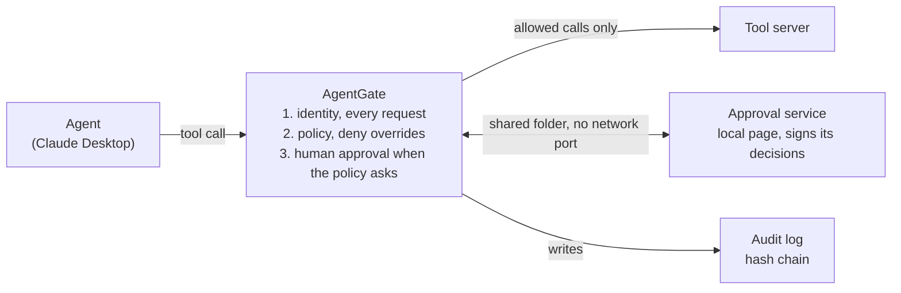
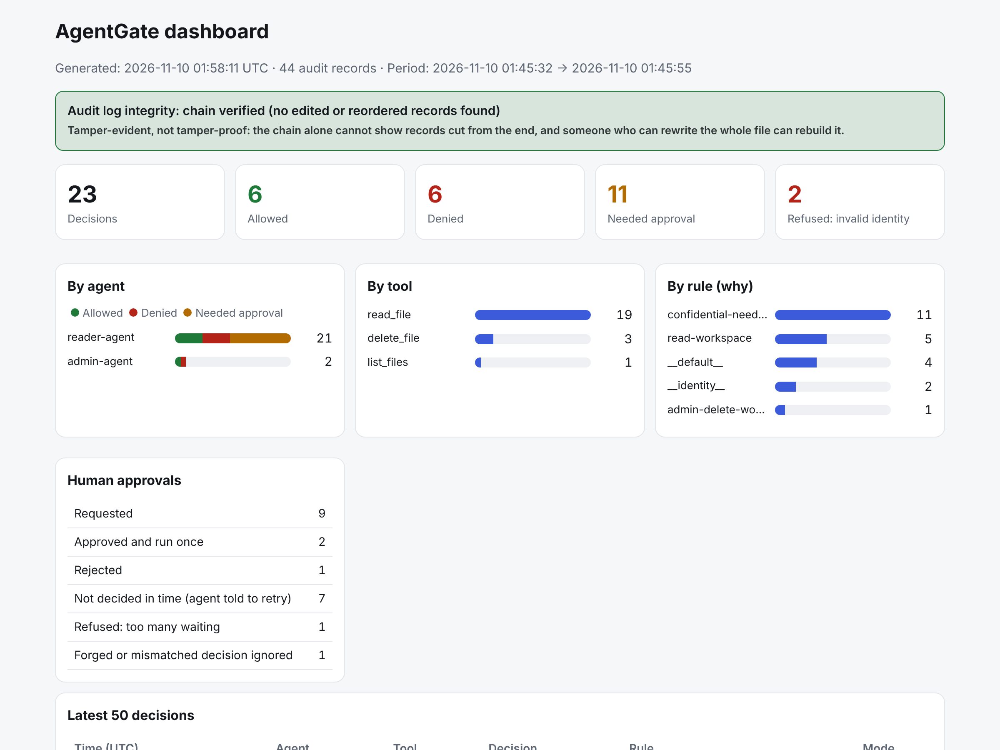

# AgentGate

[](https://github.com/mohasaif821-hub/AgentGate/actions/workflows/ci.yml)

**A least-privilege authorization layer between AI agents and their tools.**

AgentGate sits on the Model Context Protocol (MCP) tool-call path. Every tool
call an agent makes is checked against the policy, the agent's signed identity
and, when the policy asks for it, a human approval, before the tool runs. Every
decision goes to a hash-chained audit log.



## Why

Agents read, delete and run things on their own, and usually with every
permission of the user who started them. An agent tricked by text hidden in a
file makes its mistake with all of those permissions. AgentGate gives each
agent only what its role needs, and checks every call separately.

## What it does

| | |
|---|---|
| **Deny by default, deny overrides** | A call no rule allows is refused; a matching deny rule always wins, whatever the rule order. |
| **Real-path checks** | Paths are checked after `..`, symbolic links and junctions are resolved (not hard links, see [Limits](#limits)). |
| **Least privilege by role** | Each role gets its own tools and paths; tools a role can never use are hidden from it. |
| **Signed identity, checked on every request** | Ed25519 tokens with signed expiry and id, a lifetime cap, and a signed revocation list that refuses rollback. |
| **Human approval bound to one request** | A signed decision from a separate approval service, valid for that exact request, once. It never changes the agent's permissions. |
| **Generic denials** | The agent learns nothing about why it was refused; the details are in the audit log only. |
| **Hash-chained audit log** | Safe with several AgentGate processes on one log; a call that can't be logged doesn't run. |
| **Dashboard** | One static HTML page from the audit log, in English and Arabic. |
| **Regulatory mapping** | NCA ECC-2:2024, SAMA CSF and OWASP Agentic Top 10 2026, generated from one data file and guarded by tests. |



## Results

68 scenarios, written and frozen before the first run, played against the real
AgentGate. A scenario passes only when AgentGate's reply, the tool server's own
log and the audit log all agree.

| | Windows | Linux | Target |
|---|---|---|---|
| Clear violations stopped | 32 / 32 | 32 / 32 | ≥ 98% |
| Ambiguous cases handled correctly | 18 / 19 | 10 / 11 | ≥ 80% |
| Legitimate requests allowed | 17 / 17 | 15 / 15 | — |
| False positives | 0% | 0% | — |

The one miss is a known finding: a **hard link** placed inside the workspace
(scenario A09). The evaluation runs on GitHub on every change.

## Quickstart

AgentGate is **not** on PyPI. Do not `pip install agentgate` from PyPI: a
package with that name, if one exists, is not this project.

```bash
git clone https://github.com/mohasaif821-hub/AgentGate
cd AgentGate
python -m pip install -e ".[crypto,yaml]"

python examples/demo_setup.py        # demo folder with dummy data, keys and tokens
python examples/demo_check.py        # 41 checks of the demo
python evaluation/run_eval.py        # the 68 scenarios
```

Connect the demo to Claude Desktop (quit it first; the old config is backed up):

```bash
python examples/demo_setup.py --install-claude-config
```

Approval page and dashboard (`<demo>` is the demo folder, `AgentGateDemo` in
your home folder by default):

```bash
agentgate approver --queue <demo>/approvals --private-key-file <demo>/keys/approver_private_key.hex
agentgate dashboard --audit <demo>/audit.jsonl --out dashboard.html            # --lang ar for Arabic
```

> **Monitor mode blocks nothing.** `run --mode monitor` only records what
> would have happened. It needs `--i-understand-this-disables-protection` and
> is for an isolated test environment with dummy data only.

## Limits

- **It does not detect or prevent prompt injection by itself.** It limits what
  a tricked agent can do with its tools, but doesn't know the agent was tricked
  and doesn't stop misuse of an allowed tool.
- **It doesn't protect paths that bypass it,** such as a shell or another MCP
  server the agent can reach directly.
- **Time-of-check to time-of-use (TOCTOU) risk remains** between the path check
  and the tool opening the file.
- **The audit log is tamper-evident, not tamper-proof.** Edits and reordering
  show; lines cut from the end, or a fully rebuilt chain, do not.
- A **hard link** in the workspace bypasses the path check (A09). AgentGate, the
  approval service and the agent on **one OS account** are not truly separated.
  No MFA and no SIEM integration.

The full list is in the [report](docs/REPORT.md#limits).

## Documentation

- [Final report](docs/REPORT.md): principles, architecture, evaluation, findings, limits, future work
- [Using AgentGate](docs/USAGE.md): every protection and its options (identity, revocation, approval, audit log, monitor mode)
- [Regulatory mapping](docs/regulatory-mapping.md): NCA, SAMA and OWASP, row by row
- [Evaluation reports](evaluation/results/): Windows and Linux
- [Changelog](CHANGELOG.md) · [Security policy](SECURITY.md) · [Contributing](CONTRIBUTING.md)

## Built on mcp-gate

AgentGate is built on the open-source [mcp-gate](https://github.com/rsh1k/mcp-gate)
project (Apache-2.0) and substantially extends it: the code is now 3.3 times the
original's size, and about 77% of its lines were added or changed in AgentGate
(measured with [`tools/compare_upstream.py`](tools/compare_upstream.py)).
Credit and licence notices are in [`NOTICE`](NOTICE); the original mcp-gate
documentation is kept unchanged in
[`docs/upstream-archive/`](docs/upstream-archive/ABOUT-THIS-ARCHIVE.md).

## Licence

Apache-2.0, see [`LICENSE`](LICENSE) and [`NOTICE`](NOTICE).
Copyright 2026 Mohammed Jadulhaqq, for the modifications and additions made in
AgentGate.
