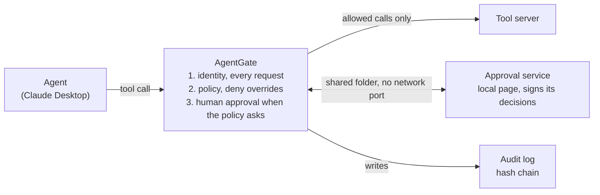

# AgentGate: final report

Mohammed Jadulhaqq

| | |
|---|---|
| Repository | https://github.com/mohasaif821-hub/AgentGate |
| Code version | `b0fc761` |

Every evaluation result, test count and code-size figure in this report was
produced from the code at this version. Later commits that change only
documentation or labels do not change them; if the code changes, the numbers
may change.

Contents: [What AgentGate is](#what-agentgate-is) ·
[Security principles](#security-principles) ·
[Architecture](#architecture-and-request-flow) · [Features](#features) ·
[Built on mcp-gate](#built-on-mcp-gate) · [Evaluation](#evaluation-results) ·
[Regulatory mapping](#regulatory-mapping) ·
[Findings and lessons](#security-findings-and-engineering-lessons) ·
[Limits](#limits) · [Future work](#future-work) · [How to run](#how-to-run)

## What AgentGate is

AgentGate is a layer that controls what AI agents are allowed to do. It sits
between an agent and the tools it uses: every tool call the agent sends passes
through AgentGate first and is checked before it runs.

The check answers four questions. Does the policy allow this call? Is the
agent's identity signed and valid, not expired and not revoked? Does the policy
require a person to approve this call? Then the call either runs or is refused,
and every decision is written to a hash-chained log.

### The problem it addresses

Agents now read files, delete them and run commands on their own. An agent can
be tricked by text hidden inside a file, or use a tool in a way its owner never
intended.

The bigger problem is that an agent usually holds all the permissions of the
user who runs it, so any mistake it makes is made with all of those
permissions.

AgentGate applies least privilege to every call separately: an agent gets only
what its role needs, and a call the policy marks as needing approval runs only
after a valid human approval.

| Term | Meaning |
|---|---|
| MCP | Model Context Protocol: the protocol that connects an agent to its tools. AgentGate works on it. |
| Least privilege | Every party gets only what it needs. |
| Audit log | A record of every decision, linked by hashes that reveal edits. |

## Security principles

AgentGate is built on 8 principles. Each one has a test or an evaluation
scenario that demonstrates it.

| # | Principle | What it means in practice |
|---|---|---|
| 1 | Deny by default | A call that no explicit rule allows is refused. |
| 2 | Deny overrides | If a deny rule and an allow rule both match a call, the deny wins, whatever the order of the rules in the file. |
| 3 | Least privilege by role | Each agent has a role, and the role sets the allowed tools and paths. A tool a role can never use is not even shown to it. |
| 4 | No identity, no start | Without a valid signed token, AgentGate refuses to start. Identity is checked on every request, not only at start. |
| 5 | One approval, one request | A human approval covers one request with its exact arguments, once, and never changes the agent's permissions. |
| 6 | When in doubt, refuse | Any internal error, missing or edited file, or path that cannot be resolved ends in a refusal. |
| 7 | No hints to an attacker | The denial the agent sees is generic: no rule name and no reason. The details are only in the audit log. |
| 8 | Tampering shows | Each log line is linked to the hash of the one before, so editing an existing line or changing the order shows. The hashes alone do not reveal lines cut from the end, or a chain rebuilt from scratch. |

There is one mode that switches protection off: monitor mode. It starts only
with a mandatory confirmation flag, and is meant only for an isolated test
environment with dummy data.

## Architecture and request flow



The agent never talks to the tool server directly. Every call goes through
AgentGate first; a refused call, or one still waiting for approval, never
reaches the server, and every decision is written to the log.

## Features

AgentGate has 14 features: 11 added in AgentGate, and 3 taken from mcp-gate and
extended. The last column says what shows the feature works. The table counts
only the features a user sees; the internal mcp-gate components AgentGate builds
on, such as sessions, the text threat scanner and the command line, are listed
under [Built on mcp-gate](#built-on-mcp-gate) and are not counted as features.

| Feature | What it does | Why | Source | Evidence |
|---|---|---|---|---|
| Policy engine | Reads written rules and decides: allow, deny, or needs approval | The policy becomes a file that can be read and reviewed | mcp-gate, rule precedence changed | Unit tests |
| Deny overrides | When two rules conflict, the deny wins | In the original, rule order could let an allow rule cover a deny rule | AgentGate | Unit tests and sample checks |
| Real-path check | Follows a path to where it really points before deciding | Stops `..` tricks, symbolic links and junctions, but not a hard link (A09) | AgentGate | Scenarios A01 to A08, A12 to A19 |
| Least privilege by role | Each role has its own tools and paths | The reader can't delete; the admin can't leave the workspace | AgentGate | C02, C03, C08, C09 |
| Tool hiding | A tool a role can never use is not shown to it | The agent doesn't know it exists, and if it calls it anyway, the call is refused | AgentGate | C01, C02 |
| Generic denials | The agent sees only a refusal, with no reason | No hint for an attacker about where to try next | AgentGate | Self-check |
| Signed identity | A token per agent holding its role, expiry and a unique id, all inside the signature | The role can't change and the lifetime can't be extended without a new signature | mcp-gate, expiry, id and checks added | C12 to C17 |
| Identity check on every request | Signature, expiry and revocation are checked before every request | A token that expires or is revoked mid-session stops at once | AgentGate | C19, C20 |
| Signed revocation list | Revokes a token by its id, and refuses any list older than the last trusted one | A stolen token stops before it expires | AgentGate | C18, C19, self-check |
| Request-bound human approval | A call the policy marks waits for a signed approval valid for that call only, once | A call the policy marks as needing approval runs only after a valid human approval | AgentGate | B13, B14, C21 to C32 |
| Monitor mode | Records what would have happened, without blocking anything | Try a policy before turning it on, in an isolated environment only | AgentGate | Monitor-mode check, 8 of 8 |
| Hash-chained audit log | Every decision is recorded and linked to the hash of the one before | Editing existing lines or changing their order shows | mcp-gate, mode and token id added | Unit tests |
| Dashboard | A page built from the audit log, in English and Arabic | An operator sees the picture without reading the log | AgentGate | Unit tests |
| Regulatory mapping | Maps the features to NCA and SAMA controls and OWASP risks | The operator knows what is and isn't supported | AgentGate | Tests that block any claim without evidence |

The scenario codes in the last column come from the evaluation; the first letter
gives the type:

| Letter | Scenario type | Count |
|---|---|---|
| C | Clear violation, must be refused | 32 |
| A | Ambiguous case with a trick, such as a twisted path | 19 |
| B | Legitimate request, must be allowed | 17 |

## Built on mcp-gate

AgentGate is built on the open-source project
[mcp-gate](https://github.com/rsh1k/mcp-gate) (Apache-2.0). Its current code is
3.3 times the size of the original, and about 77% of its current lines are
lines added or changed in AgentGate. This is not a share of code written from
scratch.

| Measure | mcp-gate | AgentGate |
|---|---|---|
| Python files | 19 | 31 |
| Non-blank lines of code | 2,311 | 7,702 |
| New files | — | 12, with 3,362 lines |
| Original files changed | — | 14 of 19, 3 of them rename only |
| Original files untouched | — | 5 |
| Lines added in original files | — | 2,534, and 160 removed |
| Lines added or changed | — | 5,896, that is 76.6% of the current code |

### How it was measured

- **Baseline:** mcp-gate at commit `ae0e045`, dated 2026-10-11.
- **Counted:** non-blank Python lines in the code, tests, examples and evaluation.
- **Left out:** the licence-notice lines AgentGate added at the top of files, so
  they don't inflate the numbers.
- **Left out on both sides:** the publishing helper that moved to the archive.
- **Compared:** each original file with its current version, counting added and
  removed lines. A changed line counts as one removed and one added.
- **Share** = lines in new files + lines added to original files, divided by all
  current lines of code.
- **Reproduce it:** the measuring tool is in the repository. It is a measuring
  aid, not part of AgentGate, so it is not counted itself.

  ```bash
  git clone https://github.com/rsh1k/mcp-gate upstream
  git -C upstream checkout ae0e045
  python tools/compare_upstream.py upstream
  ```

### What came from mcp-gate

The policy-file loader, the decision model, sessions, the text threat scanner
and the NIST mapping. And the base of the hash-chained audit log, of identities,
of the proxy between agent and tool, and of the command line.

### What AgentGate added

Every feature marked AgentGate in the features table, plus the evaluation, the
dashboard, the regulatory mapping and the complete Claude Desktop demo.

Credit to the original authors is kept in three ways:

- The `NOTICE` file, with the mcp-gate notice first and unchanged.
- A notice at the top of every changed file, saying what changed in it.
- The archive folder `docs/upstream-archive/`, holding the original mcp-gate
  files as their authors wrote them.

## Evaluation results

Both targets were met on both systems: 100% of clear violations were refused,
the ambiguous cases reached 94.7% on Windows, and there were no false positives.
One real vulnerability was found, and it is reported as it is.

| Measure | Windows | Linux | Target |
|---|---|---|---|
| Clear violations | 32 of 32 = 100% | 32 of 32 = 100% | at least 98% |
| Ambiguous cases | 18 of 19 = 94.7% | 10 of 11 = 90.9% | at least 80% |
| Legitimate requests | 17 of 17 | 15 of 15 | — |
| False positives | 0% | 0% | as low as possible |

Fewer scenarios count on Linux, because 10 are Windows-specific; they are shown
as skipped and not counted.

### How the evaluation works

- **68 scenarios:** 32 clear violations, 19 ambiguous cases and 17 legitimate
  requests.
- **The expected outcome was written and frozen before the first run.** The
  SHA-256 of the scenario file is printed in every report and has not changed.
  The policy and the expectations were not adjusted after seeing the results.
- **A scenario passes only when three pieces of evidence agree:** AgentGate's
  reply is right, the tool server's own log shows whether the tool actually ran,
  and the audit log holds the right decision. A denial message alone is not
  enough.
- **It runs against the real AgentGate**, started the same way Claude Desktop
  starts it, in a temporary folder that is deleted afterwards.
- **It runs on GitHub on every change**, and the check fails if a result drops
  below its target.

Reports: [`evaluation/results/report-windows.md`](../evaluation/results/report-windows.md),
[`evaluation/results/report-posix.md`](../evaluation/results/report-posix.md).

### Test environment

| Environment | System | Python |
|---|---|---|
| Windows evaluation | Windows 11 | 3.15.2 |
| Linux evaluation | Linux | 3.13.16 |
| GitHub checks | Linux | 3.10, 3.11 and 3.12 |

The Claude Desktop version was not recorded at the time of the demo, so it is
not stated. The evaluation was run again on both systems after the audit-log
fix (see [findings](#found-during-the-work)) and gave the same results.

### Does the evaluation itself catch mistakes?

Yes. AgentGate was broken on purpose in 4 places, and each break showed up in
the scenario designed to catch it:

| Deliberate break | Caught by |
|---|---|
| The path check reads the text instead of the real path | A07, A08 |
| Identity check on every request removed | C19, C20 |
| An approval usable more than once | C25 |
| Tool hiding removed | C01 |

In the same way, 14 protections in the approval flow and its page, and 4 in the
dashboard, were removed one at a time, and the unit tests caught every one.

### The vulnerability found

**A09, hard link.** If someone with write access to the workspace places in it a
hard link to a file outside it, AgentGate allows reading it. A hard link is a
second name for the same file, so its real path is inside the workspace. The
issue exists on both Windows and Linux.

### Limits of the evaluation itself

- 68 scenarios show that what was tested is protected, not that there are no
  other vulnerabilities.
- The person who wrote the scenarios also built AgentGate, so there may be
  cases nobody thought of. A third-party review would make the numbers stronger.
- The agent in the evaluation is simulated: a program that sends the same
  requests, not a real AI agent. The Claude Desktop demo was done by hand and is
  not part of the numbers.

## Regulatory mapping

AgentGate is mapped to three references, each kept separate:

- **NCA ECC-2:2024**: the Essential Cybersecurity Controls of Saudi Arabia's
  National Cybersecurity Authority: minimum cybersecurity requirements for
  government entities in the Kingdom and for private entities that own, operate
  or host critical national infrastructure.
- **SAMA Cyber Security Framework**: the cybersecurity framework of the Saudi
  Central Bank (SAMA) for the financial-sector organisations it regulates.
- **OWASP Top 10 for Agentic Applications 2026**: a list of risks, not a
  compliance standard.

AgentGate **supports** these controls; it does not make any organisation
compliant.

| Reference | Partially supported | Not supported | Not verified | Total |
|---|---|---|---|---|
| NCA | 7 | 2 | 1 | 10 |
| SAMA | 7 | 2 | 0 | 9 |
| OWASP | 2 | 0 | 0 | 2 |
| **Total** | **16** | **4** | **1** | **21** |

No control is "Supported" in full, on purpose: AgentGate only sees the tool
calls that pass through it.

### What each row holds

- The official control number and text, and where it is in the official source.
- The support status, and the evidence: tests, evaluation scenarios and files.
- Whether the evidence was verified, and what AgentGate does **not** cover.

### Controls it does not support

| Reference | Control | Reason |
|---|---|---|
| NCA | 2.2.3.2 | A token is a single factor, and human approval is not multi-factor authentication |
| NCA | 2.12.3.5 | AgentGate never deletes the log, but how long it is kept is up to the operator |
| SAMA | 3.3.5 (4.e) | A token is a single factor |
| SAMA | 3.3.14 (4.j) | No central analysis or correlation of events |

NCA control 2-7 (data and information protection) is "Not verified", because
its sub-controls have not been read in full.

### How the mapping is kept honest

- **One data file** (`agentgate/regulatory.py`) generates the document, and a
  test fails if the two differ.
- **The test also fails** if a status contradicts its evidence, or if any named
  test, scenario or file does not exist.
- **Control numbers come from the official sources:** NCA sub-controls use dots
  (2.2.3.3) and main controls use hyphens (2-2-3), checked visually on page 20 of
  the official PDF. SAMA controls come from the official Rulebook pages for
  sections 3.3.5 and 3.3.14.
- **OWASP:** risk names come from the official announcement page. The full PDF
  was not read, so risk descriptions are not quoted.

### Sources

| Reference | Version |
|---|---|
| NCA Essential Cybersecurity Controls | ECC-2:2024 |
| SAMA Cyber Security Framework | 1.0 |
| OWASP Top 10 for Agentic Applications | 2026 |

Full document: [`docs/regulatory-mapping.md`](regulatory-mapping.md).

## Security findings and engineering lessons

### What was added or fixed in the protection

- **Deny always overrides.** If one rule allows and another denies the same
  call, it is refused. The order of the rules in the file does not change that.
- **Real-path check.** The check runs on the path after `..` segments and
  symbolic links are resolved, not on the text the agent sent. This closes
  escapes from the workspace through `..`, symbolic links and junctions, but not
  through a hard link (A09).
- **Identity check on every request.** A token that expires or is revoked
  mid-session is refused from the next request on, not only at start.
- **Approval bound to one request.** Any change to the request voids it; it can
  be used once, and it never changes the agent's permissions.

### Found during the work

- **Hard link (A09).** The one vulnerability the evaluation found, reported in
  the results.
- **The audit chain broke with no tampering.** An old log was renamed to archive
  it while the AgentGate process started by Claude Desktop was still running,
  and another process started a new log. The old process kept its counter, so it
  wrote into the new file from number 130 right after 87. `agentgate verify`
  found the gap, and the log was shown not to have been tampered with: the old
  log holds exactly 130 lines, and line 130 links to the hash of its last line.
  The evaluation missed it because every scenario runs one process.
  **Fix:** every write now takes a file lock and continues from the file's real
  last line. If the file was renamed, deleted or cut back while a process was
  running, that process refuses to write and the call is refused. A call that
  can't be logged doesn't run, even if it was approved. 7 tests were added, and
  each part of the fix was broken on purpose to confirm the tests fail. After
  the fix the same situation was repeated on the demo machine: Claude Desktop
  and the demo check wrote to the same log in turns, and the chain verified
  with 94 lines.
- **The dashboard claimed more than it proves.** Its integrity banner said the
  log had no deletions, but the chain cannot show lines cut from the end. The
  wording was fixed in both languages, and a test fails if the claim returns.
- **Claude gives up waiting without saying so.** With a dedicated probe, a
  linked session waited 45 and 55 seconds but gave up at 120 seconds, and sent
  no cancel notification. That is why the approval hold is 45 seconds; after
  that the call stays pending and runs only if the identical request is sent
  again.
- **The approval page refused logins.** A header that stops the browser sending
  the page's origin made it send an empty origin, which the check refused. The
  header was changed, confirmed with a real browser, and a test was added. The
  check itself was not weakened.
- **The approval page on Windows reset refused connections.** It answered before
  reading the request body, and Windows reset the connection, so the client
  never saw the refusal. It now reads the size-capped body first. Found by
  running the unit tests on Windows.
- **A test that showed a vulnerability that wasn't there.** The "changed request"
  test sent the same path by mistake, because the path library drops a `.`
  segment. The test was fixed; the protection was working.
- **A hypothesis disproved.** A specific error code was suspected of causing an
  odd message seen once. The probe showed it was not, so nothing was built on it.
  The error codes were changed for other, documented reasons: the old code was
  inside the JSON-RPC reserved range, and in MCP it has another meaning.

### Lessons in verification

- **Break the code on purpose to test the tests.** Every important protection
  was removed to confirm a test fails. A test that still passes without the
  protection proves nothing.
- **A failure on GitHub is not always a bug.** Some failures came from uploading
  files in batches in the wrong order. The fix: coherent batches that each work
  on their own.
- **Compare files in both directions after an upload.** Not only "did all my
  files arrive" but also "are there extra files that shouldn't be there". This
  caught compiled files uploaded by mistake.
- **Review what you inherit.** The settings carried a stale, wrong licence, and
  the old docs had a PyPI install command for a name that isn't ours. That is a
  real risk, because anyone can publish under that name. Installation is now
  from the repository only, with an explicit warning.
- **State nothing that wasn't checked.** Every command in the docs was run, and
  every control number was compared with the official source.

## Limits

These are things AgentGate does **not** do, written here plainly so it isn't
read as covering more than it does.

### Main limits

- **AgentGate does not detect or prevent prompt injection by itself.** If the
  agent is tricked, AgentGate limits what it can do with the tools, because the
  same rules apply to its calls. But it doesn't know the agent was tricked, and
  it doesn't stop misuse of an allowed tool.
- **It doesn't protect access paths that bypass it.** If the agent has another
  tool that doesn't go through AgentGate, such as a shell or another MCP server,
  those calls are never checked.
- **Time-of-check to time-of-use (TOCTOU) risk remains.** AgentGate checks the
  path, then the tool server opens it. If someone changes the file or swaps it
  for a link between the two moments, what is opened may not be what was
  checked.
- **The audit log is tamper-evident, not tamper-proof.** Editing a line breaks
  the chain and shows. But lines cut from the end don't show, and someone who
  can rewrite the whole file can rebuild the chain, or delete the file.

### Other limits

- **Hard link (A09):** allowed when placed inside the workspace and pointing
  outside. It needs write access to the workspace, which the demo agent doesn't
  have.
- **One OS account:** if AgentGate, the approval service and the agent all run
  under the same account, any program running as that account can read the keys
  and the login code, change the revocation list and its state file together, or
  change the clock. Real separation needs another account or another machine.
- **Token copying:** a token works for whoever holds it. Anyone who can read an
  existing token can use it until it expires or is revoked, but cannot create a
  new token with more permissions.
- **Waiting is 45 seconds only:** a longer approval works only when the agent
  sends the identical request again within 10 minutes. There is no long
  connected wait.
- **No multi-factor authentication:** neither for the agent nor for the approver.
- **No SIEM integration,** and no continuous monitoring or alerts. The dashboard
  is a static file regenerated on demand.
- **Log retention:** AgentGate never deletes anything, but doesn't guarantee
  retention. That is the operator's responsibility.
- **NCA control 2-7** has not been verified.
- **Monitor mode protects nothing,** and is only for an isolated environment with
  dummy data. AgentGate cannot tell whether an environment is really isolated.

## Future work

- **Close the hard-link gap (A09),** and decide how to handle the
  time-of-check to time-of-use risk.
- **Run the approval service under another account or on another machine,** so
  the separation is real.
- **Multi-factor authentication** for the approver.
- **SIEM integration,** and a retention policy for the log.
- **Safe logging of arguments,** without exposing secrets.
- **HTTP transport:** needs an independent security assessment before any use,
  because the whole current evaluation is on the local transport only.
- **Verify NCA control 2-7.**
- **A third-party review of the scenarios,** with new scenarios added in a new,
  separate file so the frozen file stays unchanged.

## How to run

AgentGate is not published on PyPI; install it from this repository only. Do
not install a package of the same name from PyPI.

**1. Install**

```bash
git clone https://github.com/mohasaif821-hub/AgentGate
cd AgentGate
python -m pip install -e ".[crypto,yaml]"
```

**2. Set up the demo.** This creates a demo folder with dummy data, keys and
tokens (default: `AgentGateDemo` in your home folder):

```bash
python examples/demo_setup.py
```

To connect it to Claude Desktop (quit the app first; the old config is backed up
before it is changed):

```bash
python examples/demo_setup.py --install-claude-config
```

**3. Check the demo**

```bash
python examples/demo_check.py
```

**4. Approval page,** in its own window (`<demo>` is the demo folder):

```bash
agentgate approver --queue <demo>/approvals --private-key-file <demo>/keys/approver_private_key.hex
```

**5. Evaluation;** the report is saved in `evaluation/results/`:

```bash
python evaluation/run_eval.py
```

**6. Dashboard** from the audit log, in English or Arabic:

```bash
agentgate dashboard --audit <demo>/audit.jsonl --out dashboard.html
agentgate dashboard --audit <demo>/audit.jsonl --out dashboard-ar.html --lang ar
```
